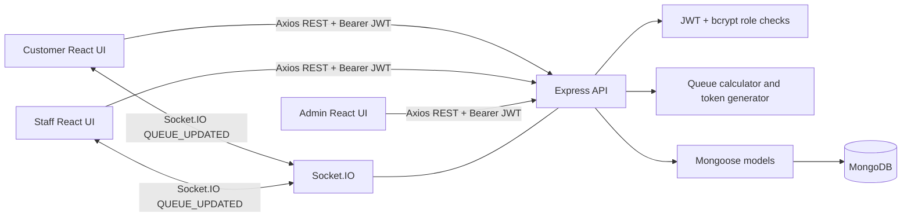
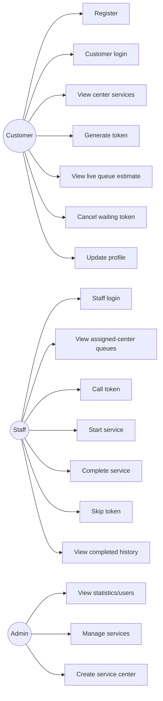
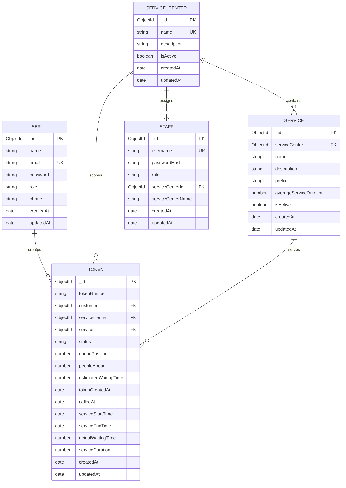

# Project Report Content Package

## QueueWise: Intelligent Queue Management and Real-Time Waiting Time Prediction System

> **Factual-source rule:** This document is an evidence-based content package for generating the college report. It describes the authored source currently present in `intelligent-queue-management`. Claims marked **Not found in source code** must not be presented as implemented features. The supplied reference report, not this document, must control formatting, font, font size, chapter numbering, page layout, certificate/declaration format, and academic presentation.

## 1. Project Title

**INTELLIGENT QUEUE MANAGEMENT AND REAL-TIME WAITING TIME PREDICTION SYSTEM (QueueWise)**

The README uses the shorter product name **Queuewise** and describes the application as an intelligent queue management and real-time waiting-time estimation system. The implementation uses transparent rule-based estimation; no machine-learning model was found.

## 2. Abstract

QueueWise is a MERN stack web application for managing queues in service environments such as banks, hospitals, government offices, railway stations, colleges, and clinics. A customer creates an account, selects an active service center at login, chooses a service, and receives a backend-generated digital token. The customer dashboard shows the token, queue position, number of people ahead, current token, and estimated waiting time.

Staff members use center-specific accounts to view the queues for every active service in their assigned center. They can call, start, complete, or skip tokens. The server records service timestamps and calculates actual waiting time and actual service duration. Completed durations are used as a historical average, while the configured average duration is used for queue estimates. Socket.IO broadcasts updated queue data to center/service rooms, and the server periodically refreshes active estimates every five seconds while a service is in progress.

The system is not an ML prediction system in the source inspected. Its “prediction” is a deterministic queue estimate based on current queue order, configured service duration, the currently running token, and up to 100 recent completed service durations for the service. MongoDB/Mongoose provides persistence; Express provides REST APIs; React/Vite provides the single-page frontend; JWT and bcryptjs provide authentication support.

## 3. Introduction

Physical queues create uncertainty, repeated crowding, and poor visibility for customers and staff. QueueWise converts a paper or verbally managed line into a digital queue. The service center and service are selected explicitly, so queues remain separate for different counters or activities.

The application has three role concepts in its backend:

- **CUSTOMER:** registers, logs in, creates and cancels a waiting token, and monitors the queue.
- **staff:** uses a provisioned center account, sees all active services in that center, performs service transitions, and views completed history.
- **ADMIN:** is supported by protected backend routes and an admin dashboard for statistics and service creation. No public admin-registration flow was found.

The frontend is a React single-page application with path-based conditional rendering using `useLocation`, rather than a declarative `<Routes>` table. The backend is an Express application attached to an HTTP server so Socket.IO can share the server.

## 4. Problem Statement

Customers in a conventional service queue may not know:

1. Whether their request has been registered.
2. How many customers are ahead.
3. Which token is currently being served.
4. How long they may need to wait.
5. Whether they can leave temporarily without losing their position.

Staff also need a consistent way to separate queues by service, start and finish work, and retain service history. A system is required to centralize these operations, expose safe role-specific actions, and notify connected dashboards when queue state changes.

## 5. Existing System and Its Limitations

The source does not document a separate legacy application. The comparison below describes the conventional/manual queue process that the project is designed to improve, not a verified module in this repository.

| Conventional/manual approach | Limitation |
|---|---|
| Paper number or verbal queue | Customers cannot reliably see live position. |
| One undifferentiated line | Different services may have different durations and counters. |
| Manual waiting-time guess | Estimate is inconsistent and not reproducible. |
| Staff-only queue visibility | Customers must repeatedly ask for status. |
| No structured completion timestamp | Historical duration analysis is difficult. |
| Manual announcements | Updates can be delayed or missed. |

## 6. Proposed System

QueueWise provides:

- Service-center selection and center-specific active services.
- Customer registration with name, email, password, confirmation password, and a validated 10-digit phone number.
- Customer and staff login with separate flows.
- JWT-based authenticated requests.
- Role checks for customer, staff, and admin operations.
- Backend-generated token numbers using a service prefix and three-digit sequence.
- Separate queue state for each service.
- Token statuses: `WAITING`, `CALLED`, `IN_PROGRESS`, `COMPLETED`, `CANCELLED`, and `SKIPPED`.
- Queue position and people-ahead values.
- Estimated waiting time from current queue state.
- Server-recorded actual waiting and service durations.
- Staff queue operations and completed-service history.
- Socket.IO rooms and `QUEUE_UPDATED` events.
- Admin statistics and active service creation.

## 7. Objectives

1. Digitize customer queues for multiple service centers.
2. Generate unique, readable, service-specific tokens.
3. Give customers a visible queue position and waiting estimate.
4. Give staff a center-scoped dashboard for service transitions.
5. Record actual start, completion, waiting, and service duration data.
6. Update connected dashboards when queue state changes.
7. Enforce role and service-center boundaries on the server.
8. Provide an extensible MERN foundation for future notification or ML features.

## 8. Scope of the Project

### Implemented scope

- Six default centers: Bank, Hospital, Government Office, Railway Station, College, and Clinic.
- Center-specific default services with prefixes and configured average durations.
- Customer account registration, login, profile update, and logout.
- Staff provisioning from environment-configured credentials and center assignments.
- Token creation, listing, detail lookup, cancellation, call, start, completion, and skip.
- Queue estimation and historical average service duration.
- Staff history for completed records in the authenticated center.
- Admin statistics and active service creation/listing/update/deactivation APIs.
- Socket.IO queue rooms and event broadcasting.
- Responsive CSS layout and customer/staff/admin workspaces.

### Not found or not implemented in the inspected source

- No trained machine-learning model, feature pipeline, model file, or prediction service.
- No SMS, email, push-notification, QR-code, appointment, priority-queue, or multi-counter implementation.
- No automated Jest, Vitest, Mocha, Supertest, or Playwright test suite in authored source.
- No deployment manifest for Docker, Kubernetes, Vercel, Render, Railway, or a cloud provider.
- No database migration framework.
- No public staff or admin registration.
- No atomic counter collection for high-concurrency token numbering.

## 9. Functional Requirements

### Customer

1. Register with name, email, phone, password, and confirmation password.
2. Log in after selecting an active service center.
3. Receive a JWT containing the user identity, role, and selected center.
4. View active services for the selected center.
5. Select a service and generate one active token for the center.
6. View token history/current token data.
7. View queue position, people ahead, estimated waiting time, expected service duration, and current token.
8. Cancel a token only while it is `WAITING`.
9. Update profile name, email, and phone.
10. Log out by clearing session storage.

### Staff

1. Log in using a provisioned username and password.
2. Access only the assigned service center.
3. View all active service queues in that center.
4. Call waiting tokens, start called tokens, complete in-progress tokens, and skip waiting/called tokens through backend APIs.
5. View completed service history with customer, service, timestamps, and duration.

### Admin

1. Read user statistics and service statistics.
2. List users.
3. List service centers.
4. Create, update, and deactivate services.
5. Create service centers through the protected API.

### System

1. Persist entities and timestamps in MongoDB.
2. Validate role and selected-center access.
3. Emit queue updates after queue mutations.
4. Refresh active queue estimates periodically while service is in progress.

## 10. Non-Functional Requirements

These are requirements supported by the implementation or reasonable engineering qualities of the implementation; they are not claims of formal performance certification.

- **Security:** JWT verification, bcrypt password hashing, role checks, selected-center checks, protected routes, and `select: false` for password fields.
- **Consistency:** Mongoose validators, unique indexes, active-status filters, and a retry around duplicate token-number creation.
- **Availability dependency:** Runtime requires a reachable MongoDB instance and configured environment variables.
- **Responsiveness:** CSS includes a breakpoint at `max-width: 900px`; the UI is intended for desktop and smaller screens.
- **Maintainability:** Routes, models, middleware, utilities, context, and API access are separated.
- **Observability:** Morgan request logging, console errors, and `/api/health`.
- **Real-time behavior:** Socket.IO events are scoped to service-center/service rooms.
- **Data integrity:** Service references a center; token references customer, center, and service; token lifecycle timestamps are stored.
- **Not verified:** formal latency, load capacity, accessibility compliance, penetration-test status, uptime, and production security.

## 11. Hardware and Software Requirements

### Hardware

No hardware specification is encoded in source. A practical development setup requires:

- A computer capable of running Node.js, a browser, and MongoDB connectivity.
- Network access between browser, frontend, backend, and MongoDB.
- A modern browser for the React application.

### Software

Verified from `README.md`, package manifests, and source:

- Node.js 18 or newer (README requirement).
- npm.
- MongoDB locally or a MongoDB Atlas connection string.
- A modern web browser.
- React 18.3.1 and Vite 5.4.10 for the frontend.
- Node.js/Express 4.21.1 backend runtime.

## 12. Technology Stack and Justification

| Technology | Evidence | Justification in this project |
|---|---|---|
| React | `frontend/package.json`, `src/*.jsx` | Component-based customer, staff, and admin UI. |
| Vite | `frontend/package.json`, `vite.config.js` | Frontend development server and production build. |
| React Router DOM | `frontend/package.json`, `BrowserRouter`, `useLocation`, `Navigate` | Browser history and navigation helpers; rendering itself is path-conditional. |
| Axios | `frontend/package.json`, `src/services/api.js` | Central HTTP client and Authorization interceptor. |
| Node.js/ES modules | `backend/package.json` with `"type": "module"` | Server runtime and module organization. |
| Express | `backend/server.js`, route files | REST API routing and middleware. |
| MongoDB/Mongoose | `config/db.js`, `models/*.js` | Document persistence, schemas, references, indexes, validators. |
| JSON Web Token | `authRoutes.js`, `authMiddleware.js` | Signed seven-day role/center claims. |
| bcryptjs | `models/User.js`, `defaultStaff.js`, `Staff.js` | Password hashing and comparison. |
| Socket.IO | `server.js`, `tokenRoutes.js`, React pages | Room-based real-time queue updates. |
| Morgan/CORS/dotenv | `server.js` | Request logging, cross-origin configuration, and environment loading. |
| CSS/Google Fonts | `global.css` | Responsive visual design using Manrope, DM Mono, and Playfair Display. |

## 13. System Architecture

### Verified component architecture

1. A React/Vite browser client renders customer, staff, and admin workspaces.
2. Axios calls the Express REST API under `/api`.
3. The API authenticates requests using a bearer JWT.
4. Express route handlers query and update Mongoose models.
5. Mongoose connects to MongoDB using `MONGO_URI`.
6. Socket.IO is attached to the same Node HTTP server.
7. Clients join a service-center/service room.
8. Token actions rebuild the relevant queue and emit `QUEUE_UPDATED`.
9. A five-second server timer broadcasts active queues while an `IN_PROGRESS` token exists.



## 14. System Workflow

1. The server loads `.env`, creates Express and Socket.IO, connects to MongoDB, synchronizes token indexes, ensures default centers/services, provisions staff, then starts listening.
2. A new customer opens the portal, signs up, and is redirected to customer login.
3. The login page fetches active service centers from `GET /api/service-centers`.
4. The customer logs in with email, password, and selected center.
5. The server verifies credentials, signs a seven-day JWT with `serviceCenterId`, and returns public user data.
6. The customer dashboard requests services and the customer’s tokens.
7. The customer selects a service and calls `POST /api/tokens`.
8. The server validates the service and center, prevents another active token in that center, creates a prefix-based token, builds the queue, and returns queue information.
9. The customer joins the Socket.IO room for the selected service.
10. Staff logs in through `/api/auth/staff/login`; the JWT contains the staff center.
11. Staff loads center queues and joins each center/service room.
12. Staff calls or starts the next token. Starting records `serviceStartTime` and `actualWaitingTime`.
13. While the service is active, the server recalculates remaining time and emits updates every five seconds.
14. Staff completes the token. The server records `serviceEndTime`, calculates `serviceDuration`, marks it `COMPLETED`, and emits the new queue.
15. Staff history reads completed records scoped to the staff center.

### Practical Bank and Clinic example

Suppose a customer selects **Bank → Cash Deposit**, whose configured average is 6 minutes. If two waiting tokens are ahead and no service is in progress, the estimate is `2 × 6 = 12 minutes`. The customer receives a token such as `D001` (the exact number depends on the latest token for that service).

If another customer selects **Clinic → General Consultation**, that customer is in a separate center and service queue. The Bank token does not count Clinic customers because the queue query filters by `service`, and every service belongs to a specific `ServiceCenter`.

If a Bank token is already in progress and its assigned duration is 6 minutes, the calculator substitutes the current remaining service time for one full six-minute block. When the Bank service completes, the actual duration is recorded. That actual duration contributes to the service’s historical average, but it does not rewrite transient estimates into MongoDB every five seconds.

## 15. Use Case Diagram Description

### Actors

- Customer
- Staff
- Admin
- MongoDB persistence is a supporting system, not a human actor.

### Main use cases

| Actor | Use cases |
|---|---|
| Customer | Register, log in, select center, view services, generate token, view queue, cancel waiting token, update profile, log out |
| Staff | Log in, view center queues, call token, start service, complete service, skip token, view history, view profile |
| Admin | View users/statistics, create service center, create/update/deactivate service, access token queue/action APIs |



## 16. ER Diagram Description

### Relationships verified from Mongoose references

- A `ServiceCenter` has many `Service` documents.
- A `ServiceCenter` has many `Token` documents.
- A `ServiceCenter` is assigned to many `Staff` documents.
- A `User` customer can have many historical tokens, but a partial unique index permits at most one active (`WAITING`, `CALLED`, or `IN_PROGRESS`) token per center.
- A `Service` has many `Token` documents.
- A `Token` references exactly one customer (`User`), one center, and one service.



## 17. Database Design

### `User` model (`backend/models/User.js`)

| Field | Type/rules | Meaning |
|---|---|---|
| `name` | String, required, trimmed | Customer name. |
| `email` | String, required, unique, lowercase, trimmed | Login identity. |
| `password` | String, required, min 6, `select: false` | Hashed by a pre-save bcrypt hook. |
| `role` | Enum `CUSTOMER`, `STAFF`, `ADMIN`; default `CUSTOMER` | User role. |
| `phone` | String, trimmed | Customer phone profile. |
| `createdAt`, `updatedAt` | Mongoose timestamps | Record lifecycle. |

### `Staff` model (`backend/models/Staff.js`)

| Field | Type/rules | Meaning |
|---|---|---|
| `username` | String, required, unique, trimmed | Staff login identity. |
| `passwordHash` | String, required, `select: false` | Bcrypt hash. |
| `role` | Enum `staff`, default `staff` | Staff authorization value. |
| `serviceCenterId` | ObjectId ref `ServiceCenter`, required | Assigned center. |
| `serviceCenterName` | String, required, trimmed | Denormalized display name. |
| timestamps | Mongoose timestamps | Record lifecycle. |

### `ServiceCenter` model (`backend/models/ServiceCenter.js`)

`name` is a required unique trimmed string; `description` is an optional trimmed string; `isActive` defaults to `true`; timestamps are enabled.

### `Service` model (`backend/models/Service.js`)

| Field | Type/rules | Meaning |
|---|---|---|
| `serviceCenter` | ObjectId ref `ServiceCenter`, required | Owning center. |
| `name` | Required trimmed String | Service name. |
| `description` | Trimmed String | Service explanation. |
| `prefix` | Required uppercase trimmed String, max length 3 | Token prefix. |
| `averageServiceDuration` | Number, default 10, min 1 | Assigned duration in minutes. |
| `isActive` | Boolean, default true | Soft availability flag. |

### `Token` model (`backend/models/Token.js`)

The token status enum is `WAITING`, `CALLED`, `IN_PROGRESS`, `COMPLETED`, `CANCELLED`, or `SKIPPED`. References are `customer → User`, `serviceCenter → ServiceCenter`, and `service → Service`. Timing values are stored in minutes for numeric durations and dates for timestamps.

Indexes:

1. `{ service: 1, tokenCreatedAt: 1 }` supports service queue ordering.
2. `{ service: 1, tokenNumber: 1 }` is unique, preventing duplicate token numbers within a service.
3. A partial unique index on `{ customer: 1, serviceCenter: 1 }` applies only to active statuses, preventing multiple active center tokens for a customer.

## 18. Module Description

| Module | Files | Responsibility |
|---|---|---|
| Server bootstrap | `backend/server.js` | Express, CORS, JSON, logging, health route, route mounting, Socket.IO, startup initialization. |
| Database | `backend/config/db.js` | Mongoose connection using `MONGO_URI`. |
| Authentication | `backend/routes/authRoutes.js`, `backend/middleware/authMiddleware.js`, `frontend/src/context/AuthContext.jsx` | Registration, login, JWT, bearer verification, role checks, session persistence. |
| Centers/services | `backend/models/ServiceCenter.js`, `Service.js`, service routes, default seed utility | Center/service setup and admin management. |
| Token lifecycle | `backend/models/Token.js`, `backend/routes/tokenRoutes.js` | Creation, lookup, cancellation, call, start, completion, skip. |
| Queue calculation | `backend/utils/queueCalculator.js` | Average duration, remaining duration, wait estimate, queue construction. |
| Token numbering | `backend/utils/tokenGenerator.js` | Reads latest service token and increments prefix sequence. |
| Staff operations | `backend/routes/staffRoutes.js`, `frontend/src/StaffPages.jsx` | Center queue dashboard and completed history. |
| Admin | `backend/routes/adminRoutes.js`, admin portion of `frontend/src/App.jsx` | Statistics, user list API, service creation UI. |
| Real time | `server.js`, `tokenRoutes.js`, `App.jsx`, `StaffPages.jsx` | Rooms and `QUEUE_UPDATED`. |
| Presentation | `frontend/src/App.jsx`, `StaffPages.jsx`, `global.css` | Portal, forms, dashboards, responsive visual language. |
| Provisioning | `backend/utils/defaultServices.js`, `defaultStaff.js`, `scripts/seedServices.js` | Idempotent centers/services and staff setup. |

## 19. Frontend Design and User Interface

### Screens and behavior

- **Portal selection:** routes the visitor to customer or staff login.
- **Customer signup/login:** forms validate required fields in the browser; login loads active service centers.
- **Customer dashboard:** service selection, token generation, current visit card, queue metrics, cancellation, and Socket.IO updates.
- **Customer profile:** displays and edits name, email, and phone.
- **Staff login:** username/password form.
- **Staff dashboard:** assigned-center service queues, waiting/in-progress metrics, start/complete actions, and history view.
- **Staff profile:** username, role, and assigned center.
- **Admin dashboard:** statistics, active services, centers, and new-service form.

### Visual design evidence

`frontend/src/styles/global.css` defines a paper-like light background, dark sidebar, lime/coral accents, responsive grid layout, dashboard panels, status pills, and responsive behavior. The CSS imports `Manrope`, `DM Mono`, and `Playfair Display` from Google Fonts. The exact reference-report typography must be applied by Claude to the final academic document; it is not the same thing as the application UI font.

### Client state and session

`AuthContext.jsx` stores `queuewise_token` and `queuewise_user` in `sessionStorage`; it removes legacy local-storage keys. `api.js` reads the session token and adds a bearer Authorization header. The `AuthProvider` calls `/auth/me` on reload when a token exists.

## 20. Backend Architecture and API Design

The backend uses route modules mounted by `server.js`:

```text
/api/auth           authRoutes.js
/api/services       serviceRoutes.js
/api/service-centers serviceCenterRoutes.js
/api/tokens         tokenRoutes.js
/api/admin          adminRoutes.js
/api/staff          staffRoutes.js
```

Every asynchronous route catches its own errors and calls `next(error)` or returns a specific status. `notFound` produces a 404 JSON response. `errorHandler` logs the error and returns 400 for Mongoose validation errors or 500 with a generic message for other server errors.

## 21. Authentication and Authorization

1. Customer passwords are hashed by the `User` pre-save hook using bcrypt cost 12.
2. Staff passwords are hashed by `ensureStaffAccounts` using bcrypt cost 12 and stored as `passwordHash`.
3. Login signs a JWT with `{ userId, role, serviceCenterId }`, expiring in seven days.
4. `authenticateUser` requires `Authorization: Bearer <token>`, verifies the JWT, loads either `Staff` or `User`, and places the document and center claim on the request.
5. `authorizeRole` performs case-insensitive role checks.
6. Customer services/tokens are tied to the selected center claim.
7. Staff queue and history are scoped to the assigned center from the JWT; frontend-supplied center IDs are not trusted for staff scope.
8. Customers may access only their own token detail and cancel only their own waiting token.

No secrets, passwords, or connection strings are reproduced here. The source contains `.env.example` placeholders and default development staff values in provisioning code/README; these must not be copied into a public report as credentials.

## 22. Token Generation and Queue Management

`nextTokenNumber(service)` finds the newest token for the service, matches the service prefix followed by digits, increments the numeric part, and pads it to three digits. If no matching token exists, numbering starts at 1. For example, prefix `D` produces `D001`, then `D002`.

The create-token route:

1. Validates service and center ObjectIds.
2. Confirms the center and service are active and related.
3. Checks the customer has no active token in the center.
4. Creates a token with customer, center, service, and generated number.
5. Retries up to three attempts if the unique service/token-number index reports a duplicate.
6. Builds the queue and returns dynamic queue information.

Queue order is service-specific and sorted by `tokenCreatedAt`. Active statuses are waiting, called, and in progress. The current token is the first `IN_PROGRESS` token; the remaining active records form the displayed queue. Queue calculations are rebuilt from current database state.

## 23. Waiting-Time Prediction Algorithm

### Important terminology

- **Expected/configured service duration:** `Service.averageServiceDuration`, in minutes. It is set per service, for example 6 minutes for Bank Cash Deposit.
- **Estimated waiting time:** a dynamic estimate returned by `calculateWaitingTime`; it is not written as a transient value every five seconds.
- **Actual waiting time:** recorded when service starts:
  `serviceStartTime - tokenCreatedAt`.
- **Actual service duration:** recorded when service completes:
  `serviceEndTime - serviceStartTime`.
- **Queue position:** the displayed one-based position among waiting/called tokens, not a global position across centers.
- **Real-time communication:** Socket.IO transports newly calculated queue objects. It does not calculate time itself.

### Baseline formula

When no service is in progress:

```text
Estimated Waiting Time = People Ahead × Assigned Service Duration
```

When a service is in progress:

```text
Estimated Waiting Time =
Remaining Current Service Time
    + (People Ahead - 1) × Assigned Service Duration
```

The code clamps negative counts and rounds the result to the nearest minute.

### Historical average

`calculateAverageServiceTime` averages positive `serviceDuration` values from completed tokens. `buildQueue` reads up to 100 completed tokens for the service and falls back to `service.averageServiceDuration` if there are no usable durations. This historical average is returned as `averageServiceDuration` and is used as a late-service fallback; the ordinary per-customer estimate uses the service’s assigned duration.

### Overdue service behavior

`calculateRemainingServiceTime` uses the assigned duration until it is exceeded. If the active service is late, it uses the larger historical/assigned fallback as its expected total and preserves a conservative minimum of one minute remaining until staff completes it. This avoids displaying a negative remaining time.

### Example

For assigned duration 6 minutes:

- No active service and 3 people ahead: `3 × 6 = 18 minutes`.
- One active service has 2 minutes remaining and there are 3 people ahead including that active customer: `2 + (3 - 1) × 6 = 14 minutes`.
- The UI rounds and formats the estimate as a whole number of minutes.

### What is not claimed

The source does not contain regression, neural-network, time-series, or ML inference code. The report must call this a **rule-based real-time waiting-time estimation algorithm**, unless the project is later changed.

## 24. Real-Time Updates Using Socket.IO

The server creates Socket.IO with the configured client origin. A client sends:

```js
socket.emit('join-service', {
  serviceCenterId,
  serviceId
});
```

The server joins:

```text
service-center:<serviceCenterId>:service:<serviceId>
```

After token creation, call, start, completion, skip, or cancellation, `emitQueue` rebuilds the service queue and emits `QUEUE_UPDATED` to that room. `attachTokenSocket` also starts a five-second interval that finds services with an `IN_PROGRESS` token and broadcasts recalculated queues. The frontend customer and staff dashboards listen for `QUEUE_UPDATED`, merge the relevant token information, and refresh data as implemented in their respective components.

## 25. Implementation Details

- Startup is promise-chained: database connection → token index synchronization → default center/service setup → staff provisioning → HTTP listen.
- Default center setup uses `findOneAndUpdate` with upsert, so it is intended to be repeatable.
- Legacy services without a center are assigned based on prefix mapping; legacy tokens without a center inherit their service center.
- Service deletion is a soft deactivation (`isActive: false`).
- Staff credentials may be overridden using environment variables; only hashes are stored.
- The API health endpoint is `GET /api/health` and returns `{ status: "ok", service: "queuewise-api" }`.
- CORS uses `CLIENT_URL` or `http://localhost:5173`.
- The frontend API base URL is `VITE_API_URL` or `http://localhost:5000/api`; Socket.IO uses `VITE_SOCKET_URL` or `http://localhost:5000`.
- The source has no repository-level test runner script. Backend package scripts are `dev`, `start`, `seed:services`, and `seed:staff`; frontend scripts are `dev`, `build`, and `preview`.

## 26. Important Source-Code Excerpts

The excerpts below are copied from the authored source inspected. Ellipses are used only to keep a selected function excerpt concise; they do not indicate missing project behavior.

### 26.1 Password hashing

**File:** `backend/models/User.js`  
**Symbol:** `userSchema.pre('save')`

```js
userSchema.pre('save', async function save(next) {
  if (!this.isModified('password')) return next();
  this.password = await bcrypt.hash(this.password, 12);
  next();
});
```

**Explanation:** New or modified user passwords are hashed before persistence. `comparePassword` uses bcrypt for login verification. Staff provisioning uses the same cost factor for `passwordHash`.

### 26.2 JWT creation and bearer verification

**Files:** `backend/routes/authRoutes.js`, `backend/middleware/authMiddleware.js`  
**Symbols:** `sign`, `authenticateUser`

```js
const sign = (user, serviceCenterId = null) =>
  jwt.sign(
    { userId: user._id, role: user.role, serviceCenterId },
    process.env.JWT_SECRET,
    { expiresIn: '7d' }
  );
```

```js
const header = req.headers.authorization;
if (!header?.startsWith('Bearer ')) {
  return res.status(401).json({ message: 'Authentication required' });
}
const payload = jwt.verify(header.slice(7), process.env.JWT_SECRET);
```

**Explanation:** Login signs identity, role, and center scope. Middleware verifies the token and loads the matching `User` or `Staff` record before protected handlers run.

### 26.3 Token generation

**File:** `backend/utils/tokenGenerator.js`  
**Symbol:** `nextTokenNumber`

```js
export async function nextTokenNumber(service) {
  const latest = await Token.findOne({ service: service._id })
    .sort({ createdAt: -1 }).select('tokenNumber');
  const match = latest?.tokenNumber
    ?.match(new RegExp(`^${service.prefix}(\\d+)$`, 'i'));
  const number = match ? Number(match[1]) + 1 : 1;
  return `${service.prefix}${String(number).padStart(3, '0')}`;
}
```

**Explanation:** Token numbering is generated on the backend from the service prefix. The unique compound index and create retry reduce duplicate-number failures, although a dedicated atomic counter is identified by the README as a future high-concurrency improvement.

### 26.4 Queue calculation

**File:** `backend/utils/queueCalculator.js`  
**Symbols:** `calculateWaitingTime`, `buildQueue`

```js
export function calculateWaitingTime(
  peopleAhead, assignedMinutes, activeToken,
  lateFallbackMinutes = assignedMinutes, now = Date.now()
) {
  const waitingAhead = Math.max(0, Number(peopleAhead) || 0);
  const assignedDuration = Number.isFinite(Number(assignedMinutes))
    && Number(assignedMinutes) > 0 ? Number(assignedMinutes) : 0;
  const activeRemaining = activeToken
    ? calculateRemainingServiceTime(
        assignedDuration, activeToken, lateFallbackMinutes, now
      )
    : 0;
  const waitingCustomersAhead = activeToken
    ? Math.max(0, waitingAhead - 1) : waitingAhead;
  return Math.max(
    0,
    Math.round(activeRemaining + waitingCustomersAhead * assignedDuration)
  );
}
```

**Explanation:** The active token is represented by remaining time rather than another full assigned block. Waiting records are mapped with one-based queue position, people ahead, status, and estimate.

### 26.5 MongoDB queue query

**File:** `backend/utils/queueCalculator.js`  
**Symbol:** `buildQueue`

```js
const activeStatuses = ['WAITING', 'CALLED', 'IN_PROGRESS'];
const active = await Token.find({
  service: service._id,
  status: { $in: activeStatuses }
}).sort({ tokenCreatedAt: 1 });
const completed = includeCompleted
  ? await Token.find({
      service: service._id,
      status: 'COMPLETED',
      serviceDuration: { $gt: 0 }
    }).sort({ serviceEndTime: -1 }).limit(100)
  : [];
```

**Explanation:** Queue state is service-specific and time ordered. Completed records supply the historical average used by the calculator.

### 26.6 Token creation route

**File:** `backend/routes/tokenRoutes.js`  
**Route:** `POST /api/tokens`

```js
const existing = await Token.findOne({
  customer: req.user._id,
  serviceCenter: serviceCenter._id,
  status: { $in: ['WAITING', 'CALLED', 'IN_PROGRESS'] }
});
if (existing) {
  return res.status(409).json({
    message: 'You already have an active token in this service center.'
  });
}
token = await Token.create({
  tokenNumber: await nextTokenNumber(service),
  customer: req.user._id,
  serviceCenter: serviceCenter._id,
  service: service._id
});
```

**Explanation:** The route validates center/service ownership, enforces one active center token per customer, writes the MongoDB document, then rebuilds and broadcasts the queue.

### 26.7 Start and complete service

**File:** `backend/routes/tokenRoutes.js`  
**Routes:** `POST /api/tokens/:id/start`, `POST /api/tokens/:id/complete`

```js
token.status = 'IN_PROGRESS';
token.serviceStartTime = new Date();
token.actualWaitingTime = calculateActualWaitingTime(
  token.tokenCreatedAt, token.serviceStartTime
);
await token.save();
```

```js
token.status = 'COMPLETED';
token.serviceEndTime = new Date();
token.serviceDuration = calculateServiceDuration(
  token.serviceStartTime, token.serviceEndTime
);
await token.save();
```

**Explanation:** The server, not the browser, timestamps transitions. This separates actual waiting time from actual service duration and supplies future historical averages.

### 26.8 Socket.IO update

**File:** `backend/routes/tokenRoutes.js`  
**Symbols:** `attachTokenSocket`, `emitQueue`

```js
queueRefreshTimer = setInterval(() => {
  broadcastActiveQueues().catch((error) =>
    console.error(
      'Unable to refresh active queue estimates:', error.message
    )
  );
}, 5000);
```

```js
if (service && io) {
  io.to(
    `service-center:${service.serviceCenter}:service:${serviceId}`
  ).emit('QUEUE_UPDATED', await buildQueue({ Token, service }));
}
```

**Explanation:** The timer handles changing remaining time while a service is in progress. Mutation handlers emit immediately after state changes.

### 26.9 Customer frontend integration

**File:** `frontend/src/App.jsx`  
**Component:** `CustomerDashboard`

```jsx
const { data } = await api.post('/tokens', {
  serviceCenterId: serviceCenter._id,
  serviceId: selected
});
setTokens((current) => [data.token, ...current]);
```

```jsx
socket.emit('join-service', {
  serviceCenterId: active.serviceCenter?._id || serviceCenter?._id,
  serviceId: active.service._id
});
socket.on('QUEUE_UPDATED', handler);
```

**Explanation:** The dashboard sends the selected center/service to the REST API, then joins the matching real-time room when it has an active token.

### 26.10 Staff history integration

**Files:** `backend/routes/staffRoutes.js`, `frontend/src/StaffPages.jsx`

```js
const records = await Token.find({
  serviceCenter: req.serviceCenterId,
  status: 'COMPLETED',
  serviceStartTime: { $exists: true, $ne: null },
  serviceEndTime: { $exists: true, $ne: null }
})
  .populate('customer', 'name email phone')
  .populate('service', 'name')
  .sort({ serviceEndTime: -1 });
```

**Explanation:** Staff history is center-scoped and populated for display. It shows customer, phone, service, server timestamps, and numeric duration.

## 27. API Endpoint Table

All paths below include the `/api` prefix when called from outside the backend. “Bearer” means `Authorization: Bearer <JWT>`.

| Method | Path | Auth/role | Request | Response/purpose |
|---|---|---|---|---|
| GET | `/health` | Public | None | Health object. |
| POST | `/auth/register` | Public | `name,email,phone,password,confirmPassword` | Creates customer or completes a legacy phone profile. |
| POST | `/auth/login` | Public | `email,password,serviceCenterId` | Returns JWT and public customer. |
| POST | `/auth/staff/login` | Public | `username,password` | Returns JWT and public staff assignment. |
| GET | `/auth/me` | Bearer | None | Returns current public user and selected center. |
| PATCH | `/auth/me` | Bearer | Optional `name,email,phone` | Updates current user profile. |
| GET | `/service-centers` | Public | None | Active centers sorted by name. |
| POST | `/service-centers` | Bearer ADMIN | Center fields | Creates a center. |
| GET | `/services` | Bearer | Optional `serviceCenterId` | Lists active services; customer/staff scope is enforced. |
| POST | `/services` | Bearer ADMIN | `serviceCenter,name,description,prefix,averageServiceDuration,isActive` | Creates service. |
| PUT | `/services/:id` | Bearer ADMIN | Service updates | Updates service with validators. |
| DELETE | `/services/:id` | Bearer ADMIN | None | Soft-deactivates service. |
| POST | `/tokens` | Bearer CUSTOMER | `serviceId`, optional `serviceCenterId` | Creates token and returns queue info. |
| GET | `/tokens/my` | Bearer CUSTOMER | None | Latest 20 customer tokens with dynamic queue info. |
| GET | `/tokens/:id` | Bearer | None | Token detail; customer ownership and center scope checked. |
| GET | `/tokens/queue/:serviceId` | Bearer STAFF/ADMIN | None | Queue for a service. |
| POST | `/tokens/:id/call` | Bearer STAFF/ADMIN | None | `WAITING` → `CALLED`. |
| POST | `/tokens/:id/start` | Bearer STAFF/ADMIN | None | `WAITING/CALLED` → `IN_PROGRESS`; records actual wait. |
| POST | `/tokens/:id/complete` | Bearer STAFF/ADMIN | None | `IN_PROGRESS` → `COMPLETED`; records duration. |
| POST | `/tokens/:id/skip` | Bearer STAFF/ADMIN | None | `WAITING/CALLED` → `SKIPPED`. |
| PATCH | `/tokens/:id/cancel` | Bearer CUSTOMER | None | Own `WAITING` token → `CANCELLED`. |
| GET | `/staff/queues` | Bearer STAFF | None | All active service queues in assigned center. |
| GET | `/staff/history` | Bearer STAFF | None | Completed records in assigned center. |
| GET | `/admin/users` | Bearer ADMIN | None | Users sorted newest first. |
| GET | `/admin/statistics` | Bearer ADMIN | None | Customer/staff/token/status counts and average completed duration. |

### Typical response shapes

```json
{
  "token": {
    "_id": "MongoDB ObjectId",
    "tokenNumber": "D001",
    "status": "WAITING",
    "queuePosition": 1,
    "peopleAhead": 0,
    "estimatedWaitingTime": 0,
    "currentToken": null
  }
}
```

The exact MongoDB ObjectId and timestamps are runtime values and must not be invented in the report.

## 28. Testing Strategy and Test Cases

### Testing strategy appropriate to the implementation

1. **Static validation:** parse all authored JavaScript files.
2. **Frontend build:** run the frontend package’s `build` script from the frontend directory.
3. **API smoke test, if MongoDB is available:** start the backend with a non-production test environment and call `/api/health`, public center listing, registration/login, service listing, token creation, and staff transitions using disposable data.
4. **Authorization tests:** verify missing/invalid bearer token, wrong role, cross-center access, and cross-customer token access.
5. **Queue tests:** verify no active service, active service replacement, late service fallback, cancellation, skip, and completion duration.
6. **Real-time test:** connect two clients to the same room and verify `QUEUE_UPDATED` after token mutations and during an active service.
7. **UI test:** verify customer, staff, and admin screens against API responses.

### Source-supported test cases

| ID | Scenario | Expected result |
|---|---|---|
| TC-01 | Register with invalid phone | HTTP 400. |
| TC-02 | Register with mismatched passwords | HTTP 400. |
| TC-03 | Login without center | HTTP 400. |
| TC-04 | Wrong customer password | HTTP 401. |
| TC-05 | Create a second active center token | HTTP 409. |
| TC-06 | Staff accesses another center’s service | Rejected by center scope. |
| TC-07 | Start token while another token is in progress for service | HTTP 409. |
| TC-08 | Complete a non-in-progress token | HTTP 400. |
| TC-09 | Cancel a completed/called token | HTTP 400. |
| TC-10 | Admin creates service with invalid center | HTTP 400/404 as route validation dictates. |
| TC-11 | Active service queue update | `QUEUE_UPDATED` emitted to matching room. |
| TC-12 | Completed service | `serviceDuration` and `serviceEndTime` are stored. |

## 29. Actual Test Results

The following checks were genuinely executed during inspection:

| Check | Result | Evidence/qualification |
|---|---|---|
| Authored JavaScript syntax check | **Passed** | `node --check` passed for 22 authored `.js` files, excluding `node_modules` and `dist`. |
| Java source inventory | **Completed** | Two `GoogleTitle.java` files inspected; they are standalone Selenium/HTTP Google-title examples, not QueueWise application code. |
| Frontend build command from workspace parent | **Not applicable** | Failed with “Missing script: build” because the parent folder has no package manifest/script. This is not the frontend package directory. |
| Frontend build from `frontend` directory | **Passed** | `npm run build` completed with Vite 5.4.21; 121 modules transformed and production assets generated in `frontend/dist`. |
| Backend runtime/API/MongoDB tests | **Not run** | Would require a configured `MONGO_URI`, `JWT_SECRET`, and running/accessible MongoDB. |
| Automated unit/integration tests | **Not found** | No authored test suite or test script was found. |

> **Update rule for Claude:** Preserve the distinction between checks that ran and checks that were not possible. Do not turn README claims into independently executed test results.

## 30. Results and Discussion

The implemented system provides a complete queue lifecycle from customer registration to token creation, staff service transition, completion history, and live queue refresh. It uses center and service references to keep Bank, Clinic, and other service environments logically separated. Server-generated timestamps make actual waiting and service duration measurable.

The system’s most important result is visibility rather than a scientifically trained forecast: customers receive a deterministic estimate that changes with queue position and current service progress. Completed duration data is retained and averaged, creating a foundation for future prediction improvements. Socket.IO reduces the need for manual refresh, while REST remains the source of mutation and initial data loading.

Because MongoDB runtime testing was not performed in this inspection, no claim is made about production data volume, deployment availability, measured latency, or end-to-end pass rate.

## 31. Advantages and Limitations

### Advantages

- Center-specific and service-specific queues.
- Clear customer and staff role separation.
- Backend-enforced authorization and center scope.
- Human-readable token numbers.
- Actual service history and duration tracking.
- Live updates without persisting every transient estimate.
- Idempotent default center/service/staff provisioning.
- Responsive dashboard styling.
- Health endpoint and request logging.

### Limitations

- Estimation is rule-based, not machine learning.
- Token-number generation is not backed by a separate atomic counter.
- MongoDB is required at runtime.
- No production deployment configuration was found.
- No automated test suite was found.
- Staff accounts are provisioned from environment/default configuration rather than a public management UI.
- One in-progress token is enforced per service, but no multiple-counter model exists.
- Browser Socket.IO handlers refresh or merge data but do not provide offline synchronization.
- Formal performance, security, and accessibility measurements were not found.

## 32. Challenges Faced and Solutions

| Challenge | Implemented solution |
|---|---|
| Keeping queues separate by location and activity | Store `serviceCenter` on services and tokens and enforce center scope from JWT claims. |
| Avoiding duplicate active tokens | Application lookup plus a partial unique MongoDB index. |
| Generating readable numbers | Service prefixes and three-digit sequence generation. |
| Showing changing wait time | Recalculate from current state and broadcast active queues every five seconds. |
| Measuring real performance | Server records start/end timestamps and computes numeric durations. |
| Supporting staff access without public staff registration | Provision staff accounts through `ensureStaffAccounts`. |
| Keeping setup repeatable | Upsert default centers/services and update provisioned staff records. |
| Handling invalid API input | ObjectId checks, field checks, Mongoose validators, 400/401/403/404/409 responses, and centralized error handling. |

## 33. Future Enhancements

These are candidates documented by the README or implied by current limitations, not implemented features:

1. Replace latest-token lookup with an atomic per-service counter.
2. Add SMS/email/push notifications when a token is near service.
3. Add QR-based token retrieval.
4. Add appointments and scheduled visits.
5. Add multiple counters/resources per service.
6. Add priority queues with transparent rules.
7. Train and evaluate an ML model after collecting enough timestamped history.
8. Add automated unit, integration, API, UI, and load tests.
9. Add deployment configuration, secret management, monitoring, and backups.
10. Add accessibility auditing and stronger validation/rate limiting.

## 34. Conclusion

QueueWise is an implemented MERN queue-management application with customer, staff, and admin workflows. It models service centers, services, users, staff, and tokens in MongoDB; secures API access with JWT/bcrypt and role checks; calculates queue estimates from current state and service history; and distributes changes through Socket.IO. Its current waiting-time feature should be described accurately as a transparent rule-based estimator. The codebase supplies a practical foundation for future notification, scaling, and machine-learning enhancements, but deployment, automated testing, and ML prediction are not verified or implemented in the inspected source.

## 35. References

Use references appropriate to the final academic style required by the supplied reference report. Verified project references are:

1. QueueWise source repository folder: `intelligent-queue-management/`.
2. `README.md` in the project root.
3. React documentation: https://react.dev/
4. Vite documentation: https://vite.dev/
5. Express documentation: https://expressjs.com/
6. MongoDB documentation: https://www.mongodb.com/docs/
7. Mongoose documentation: https://mongoosejs.com/docs/
8. JSON Web Token documentation: https://jwt.io/introduction
9. Socket.IO documentation: https://socket.io/docs/v4/
10. Axios documentation: https://axios-http.com/docs/intro

Claude should format these references according to the supplied report’s citation style. Do not fabricate access dates, authors, page numbers, or publication details.

## Source-File Inventory

### Project and configuration

| File | Inspected purpose |
|---|---|
| `README.md` | Product description, setup, feature claims, API overview, limitations, and validation notes. |
| `backend/package.json` | Backend scripts and dependencies. |
| `backend/.env.example` | Environment variable names; secrets deliberately not reproduced. |
| `frontend/package.json` | Frontend scripts and dependencies. |
| `frontend/vite.config.js` | React plugin and development port 5173. |
| `frontend/index.html` | Browser entry document and Queuewise title. |

### Backend authored source

| File | Inspected purpose |
|---|---|
| `backend/server.js` | Application bootstrap, middleware, routes, Socket.IO, startup. |
| `backend/config/db.js` | MongoDB connection. |
| `backend/middleware/authMiddleware.js` | JWT authentication and role authorization. |
| `backend/middleware/errorMiddleware.js` | 404 and error responses. |
| `backend/models/User.js` | Customer/admin user schema and password hook. |
| `backend/models/Staff.js` | Staff schema and password comparison. |
| `backend/models/ServiceCenter.js` | Center schema. |
| `backend/models/Service.js` | Service schema and center reference. |
| `backend/models/Token.js` | Token schema, statuses, references, indexes. |
| `backend/routes/authRoutes.js` | Registration, customer/staff login, current user, profile update. |
| `backend/routes/serviceCenterRoutes.js` | Center list and admin creation. |
| `backend/routes/serviceRoutes.js` | Service list and admin CRUD/soft delete. |
| `backend/routes/tokenRoutes.js` | Token lifecycle, queue responses, Socket.IO broadcasts. |
| `backend/routes/staffRoutes.js` | Staff queues and history. |
| `backend/routes/adminRoutes.js` | Admin users/statistics. |
| `backend/utils/queueCalculator.js` | Waiting, duration, average, remaining-time, and queue calculations. |
| `backend/utils/tokenGenerator.js` | Service token number generation. |
| `backend/utils/defaultServices.js` | Default centers/services and legacy migration. |
| `backend/utils/defaultStaff.js` | Staff provisioning. |
| `backend/scripts/seedServices.js` | Explicit provisioning script. |
| `backend/GoogleTitle.java` | Standalone Selenium browser-title example; not QueueWise logic. |
| `backend/selenium-test/GoogleTitle.java` | Standalone Java HTTP/title example; not QueueWise logic. |

### Frontend authored source

| File | Inspected purpose |
|---|---|
| `frontend/src/main.jsx` | React root, StrictMode, BrowserRouter, AuthProvider, CSS import. |
| `frontend/src/App.jsx` | Portal, auth, customer, staff legacy, admin, profile, routing conditions, customer Socket.IO. |
| `frontend/src/StaffPages.jsx` | Staff login, center dashboard, history, profile, staff Socket.IO. |
| `frontend/src/context/AuthContext.jsx` | Session state, login/register/profile/logout. |
| `frontend/src/services/api.js` | Axios base URL and bearer interceptor. |
| `frontend/src/styles/global.css` | UI theme, layout, forms, status styles, responsive CSS. |

### Generated or dependency content not treated as authored application behavior

`backend/node_modules/`, `frontend/node_modules/`, and `frontend/dist/` were excluded from feature analysis. They are installed/generated artifacts and do not define the project’s intended source behavior.

## Report Section-to-Source Map

| Report section | Primary evidence |
|---|---|
| Abstract, introduction, problem, proposed system | `README.md`, `frontend/src/App.jsx`, backend routes/utilities |
| Requirements and scope | All authored source; especially route authorization and UI flows |
| Technology stack | Both `package.json` files, `server.js`, `main.jsx`, `global.css` |
| Architecture/workflow | `server.js`, `api.js`, `AuthContext.jsx`, route files, Socket.IO code |
| Use case/ER/database design | `models/*.js`, route population/query code |
| Authentication | `authRoutes.js`, `authMiddleware.js`, `User.js`, `Staff.js`, `AuthContext.jsx`, `api.js` |
| Token/queue/prediction | `tokenRoutes.js`, `queueCalculator.js`, `tokenGenerator.js`, `Token.js` |
| Staff/history | `staffRoutes.js`, `StaffPages.jsx` |
| Frontend/UI | `App.jsx`, `StaffPages.jsx`, `global.css`, `main.jsx` |
| API table | `server.js` route mounts and every `backend/routes/*.js` file |
| Testing/results | Executed checks in this inspection plus README validation note, clearly separated |
| Limitations/future work | README “Known Limitations and Future Enhancements” and source gaps |

## Inspection and Verification Summary

### Files inspected

All authored files listed in the inventory above were read, including every backend model, route, middleware, utility, script, frontend source file, manifest, environment template, README, Vite configuration, HTML entry point, and both Java files. Dependency and generated build directories were not used as evidence.

### Checks run

- Authored JavaScript syntax check: passed for 22 files with `node --check`.
- Java file inventory and source inspection: two files.
- Frontend build: passed when run from `intelligent-queue-management/frontend` with `npm run build`; Vite transformed 121 modules and generated the production bundle.
- Backend runtime and database integration: not run because MongoDB credentials/availability were not verified.
- Automated tests: none found in authored source.

### Information that could not be verified

- MongoDB connection, seed operation, API end-to-end behavior, and Socket.IO behavior against a live database.
- Production deployment, uptime, performance, security audit, accessibility compliance, and actual user/customer data.
- Any reference-report font, page size, margins, chapter formatting, or pagination; those must come from the reference document supplied separately.

## Information Claude Must Preserve

Claude must use the supplied reference report as the authority for **formatting, font family, font size, line spacing, margins, page layout, chapter order, heading numbering, captions, table style, diagram placement, certificate/declaration/front matter, pagination, and academic tone**. This document is the factual source for QueueWise content. Claude must replace the reference project’s technical content with the verified QueueWise content above while preserving the reference report’s structure and visual format exactly as far as the reference permits.

Claude must not:

- Invent files, endpoints, models, fields, algorithms, test results, deployment claims, or ML functionality.
- Describe the estimator as machine learning.
- Claim that MongoDB/API/Socket.IO was end-to-end tested unless a separate recorded test is supplied.
- Include passwords, JWT secrets, MongoDB connection strings, API keys, personal customer information, or development credentials.
- Treat `GoogleTitle.java` as part of QueueWise’s implementation.
- Turn the reference report’s diagrams or sample data into QueueWise facts without matching them to this source package.

Use the Mermaid diagrams as verified diagram drafts, then adapt their typography and placement to the reference report without changing the underlying actors, entities, relationships, or data flow.
